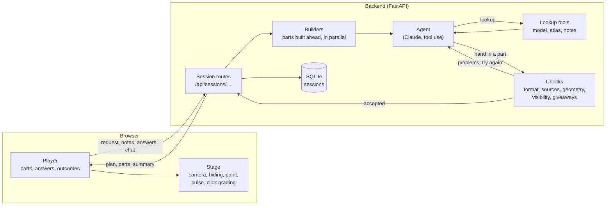

# Lumen

Lumen is an agentic 3D anatomy tutor for the heart. A student says what they need, such as "Prepare me on the blood supply of the heart", and can attach their lecture notes. A Claude agent plans a short study session and builds it one part at a time, on a 3D model of the heart. Every part is a demonstration, an animation, an experiment or a quiz. The agent adapts the plan to the student's answers.

Every fact the student reads carries a source: a quote from the anatomy atlas, a page of their notes, or a measurement taken from the 3D model. Harness code checks each part the agent hands in against the model and the sources before the student sees it.

Built for CS598 Agentic AI (BU, Fall 2026), Application track.

## Status

The core loop works end to end:

- planning, the five kinds of part, and adapting to the student's answers;
- chat during a session;
- uploaded notes;
- the summary, and a follow-up session on the shaky topics.

Current work:

- usability polish;
- reducing the wait for the first part;
- an evaluation of the agent;
- preparing the demo on Dec 10.

The plan is in [Next steps](#next-steps).

## What a session looks like

1. **Ask.** The student types a request, and can attach a PDF of their notes. If the request is too vague, the tutor asks one question first ("Is this for an exam, or to understand it?").
2. **Plan.** The tutor replies with a plan of two to five parts. It also says what the model can show and what it can only cover in words: the model has no wall territories or conducting system, for example.
3. **Parts.** The parts arrive one at a time, and the next ones are built while the student works on the current one. Each part sets the camera, hides what is in the way and highlights what matters.

   | Kind | What the student does |
   | --- | --- |
   | Demonstration | Reads sourced statements while the structures are highlighted |
   | Follow the flow | Watches a pulse travel along a vessel's route |
   | Try it | Drags a blockage along an artery and sees what loses its supply |
   | Case | Reads a patient story and clicks where the problem is. Names are hidden, and the browser grades the click |
   | Question | Multiple choice, picked with a click or the keys 1–5. The answer is shown after two wrong picks |

4. **Adapt.** After a wrong answer, the tutor decides whether to add a part aimed at that mistake. It decides at most twice per session, never after an added part, and never after the last part. The decision starts as soon as the answer is final, so the added part is usually ready by the time the student presses Next.
5. **Chat.** At any point the student can select structures and ask about them. The answer is sourced like everything else, and can change the remaining plan.
6. **Summary.** The summary shows:
   - a score (right first time);
   - each missed question, with its answer and source and a link back to it;
   - what was solid and what is worth another look;
   - every source used;
   - a button to start a new session on the shaky topics.

While the student waits, a progress line shows what the tutor is doing, for example "Building “Name the artery”: reading the atlas page on Coronary circulation · 12 s".

The app also runs without the agent, using a hand-written sample session ([`assets/fixtures/sessions/coronary_arteries.json`](assets/fixtures/sessions/coronary_arteries.json)) that costs nothing.

## System design



### The agent

One Claude model, `claude-opus-5-5` by default, handles every task: planning, building each part, chat answers, deciding what to do after a wrong answer, and the summary. Each task is a short tool-use loop. The agent looks things up, then hands in its result through a submit tool. The harness checks the result, and sends any problems back as the tool result so the agent can correct them. The prompt and the task builders are in [`backend/app/agent.py`](backend/app/agent.py), and the tool definitions are in [`backend/app/agent_tools.py`](backend/app/agent_tools.py).

| Lookup tools | What they answer |
| --- | --- |
| `describe` | What a structure or group is: what it sits inside, its atlas article, and, for a vessel, its centre-line pieces and their lengths |
| `branches_of`, `beyond`, `route` | A vessel's branches and where they leave it, what a blockage at a point cuts off, and the route between two points. All are measured on the model's centre lines |
| `find_view` | Which side a set of structures can be seen from, and what must be hidden to see them |
| `search_articles`, `read_article` | The anatomy atlas: 3,800 articles, most of them extracts of Wikipedia |
| `search_notes`, `read_notes_page` | The student's uploaded notes, page by page |

| Submit tools | What they hand in |
| --- | --- |
| `submit_plan`, `ask_student` | The plan and scope, or one question for the student before planning |
| `submit_demonstration`, `submit_pulse`, `submit_damage_slider`, `submit_click_case`, `submit_multiple_choice` | One part |
| `answer_student` | A chat answer, optionally with a new plan |
| `decide_next` | Continue, or add a part aimed at the mistake |
| `submit_summary` | What was solid and what was shaky |

### Who decides what

| The agent decides | The harness guarantees |
| --- | --- |
| What to teach, in what order, and in which kind of part | Every structure, vessel piece and distance exists in the model |
| What each statement says, and which source backs it | Every atlas or notes quote appears word for word in its source |
| What to show, hide and highlight | What a part highlights can actually be seen from the camera's side; the view is settled by measuring the model |
| The cases, questions, right answers and feedback | A question has one right answer, its wording doesn't give the answer away, and no option repeats another |
| Whether to add a part after a wrong answer | Parts are added at most twice, never after an added part, and never after the last part |
| The summary's wording | The summary's list of sources is collected by code, not by the agent |

### Formats and storage

- **Session format:** sessions use one format, `lumen.session/0.1`, shared by the backend's Pydantic models ([`session_schemas.py`](backend/app/session_schemas.py)) and the browser's types and check ([`format.ts`](frontend/src/session/format.ts)). It is described in [`docs/session_format.md`](docs/session_format.md), along with every endpoint.
- **What is stored:** each session is saved to SQLite (`data/lumen.db`), so it survives a restart. That includes the request, the parts sent, every answer, the agent's plan, its token use, and timings for each Claude call.
- **Notes:** the facts Claude reads from uploaded notes, and each page's text, are saved with the session so they can be searched. The PDF file itself is not kept.
- **History:** the browser keeps a history of past sessions, so they can be reopened.

### The model

The heart is an extract of the Z-Anatomy atlas: 41 structures in 17 groups. The vessels have sampled centre lines, so the code can measure distances, branch points, routes and what a blockage cuts off. The model, structure list and centre lines are in [`assets/regions/heart/`](assets/regions/heart/).

## Repository layout

| Path | Contents |
| --- | --- |
| `backend/app/` | FastAPI app. `sessions.py` holds the routes and tutors, `agent.py` the agent, `agent_tools.py` the tool definitions, `session_check.py` and `measure.py` the checks and geometry, `articles.py` and `notes.py` the sources, `progress.py` the progress line, `store.py` the SQLite store |
| `backend/tests/` | `pytest` tests. The agent is tested with a scripted LLM, so the tests make no API calls |
| `frontend/src/` | React and Three.js app. `viewer/` holds the 3D scene, `session/` the session player, format, grading, stage and live backend client, and `ui/` the thread, structures panel and history rail |
| `assets/` | The heart model, structure registry, centre lines, atlas articles, and sample sessions |
| `docs/` | The session format, decisions log, developer setup, asset preparation, attribution, and test checklist |

## Setup

See [`docs/dev_setup.md`](docs/dev_setup.md). In short:

```bash
cd backend && python3 -m venv .venv && source .venv/bin/activate && python -m pip install -r requirements-dev.txt
```

```bash
cd frontend && npm install
```

Run the backend on port 8000 and the frontend on port 5173 (the commands are in `docs/dev_setup.md`). By default, sessions come from the free sample. To have Claude build them, set `ANTHROPIC_API_KEY` and `SESSION_SOURCE=agent` in the repo-root `.env`. Every session then costs API credit.

Tests:

```bash
cd backend && .venv/bin/python -m pytest -q
```

```bash
cd frontend && npx vitest run && npx tsc -b --noEmit
```

## Tech stack

| Layer | Choice |
| --- | --- |
| Frontend | Vite, TypeScript, React 19, Three.js, Vitest |
| Backend | Python 3.11+, FastAPI, Pydantic v2 |
| Agent | Anthropic Claude with tool use (`anthropic` SDK) |
| Geometry | `trimesh`, `rtree`, `numpy`, for visibility and measurements on the model |
| Sources | Z-Anatomy atlas articles (word search), and student notes read with `pypdf` |
| Storage | SQLite |
| Testing | `pytest` with a scripted LLM, Vitest |

## Evaluation (planned)

The agent will be evaluated on four questions, using a fixed set of about 20 requests and simulated students that answer in set patterns (always right, wrong then right, always wrong):

- **Correct:** does each statement say only what its source says (an LLM judge, checked against hand labels)? Code can check the spatial facts against the model.
- **On topic:** does the plan cover the request, and does it say honestly what the model can't show?
- **Adaptive:** are parts added only after mistakes, and do they address the actual mistake? Do the summary and the follow-up session match what went wrong?
- **Reliable and cheap:** how often are parts accepted on the first try, what are the rejection reasons, how long until the first part, and what does a session cost in tokens and dollars?

An ablation runs the same requests through Claude without the lookup tools or the checks, then measures how many of its parts fail the checks. This shows what the harness contributes. A small pilot with classmates (a quiz before and after, plus a usability questionnaire) is optional.

## Next steps

1. **Usability:**
   - mark added parts with the reason they were added;
   - source chips that preview their quote;
   - a start screen with examples;
   - a colour key;
   - make chat easier to find;
   - accessibility.
2. **Speed:** shorten the wait for the first part, which is about a minute today (planning, then building part 1).
3. **Evaluation:** the runner and simulated students, the metrics, the ablation, then the judges.
4. **Demo:** a scripted run for Dec 10, a recorded backup session, and slides with the numbers above.
5. **Later:**
   - cross-sections (a fixed set of named cuts first);
   - searching notes by meaning for long notes, and quizzes in a course's own exam format;
   - extending beyond the heart to other regions of the body.

Design choices and their reasons are logged in [`docs/decisions.md`](docs/decisions.md).

## Team

<!-- Add every member's name and UID. -->

## Attribution

- **3D model:** Z-Anatomy, derived from BodyParts3D (CC BY-SA 4.0). Details are in [`docs/attribution.md`](docs/attribution.md).
- **Text:** Z-Anatomy's description articles. Most are extracts of English Wikipedia (CC BY-SA 4.0), and the app shows each one's source link.

Lumen is an educational prototype. It does not give medical advice.
