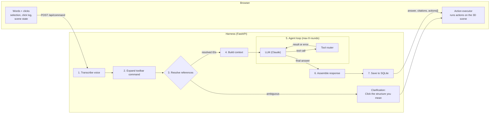

# Lumen

> **Placeholder draft**

Lumen is an agentic 3D anatomy tutor. Students explore a 3D heart, click one or several structures, and type or speak about them: "Why is this wall so thick?" or "How does blood get from here to there?" An AI agent resolves what "this" and "there" refer to, then acts directly in the 3D scene, with answers grounded in an open anatomy textbook.

Built for CS598 Agentic AI (BU, Fall 2026), Application track.

## Status

Early development. The project skeleton (React + Three.js frontend, FastAPI backend with a health check) and the extracted heart model are in place. The features and agent described below are the intended design and aren't built yet.

## Planned features

- **3D heart viewer:** about 15–18 labeled structures, with rotate, zoom, hover highlight, layers, undo and reset.
- **Multi-select with chips:** click to select, Shift-click to add, with selection order preserved.
- **Reference resolution:** "this", "these", "here" and "there" map to the clicked structures. Ambiguous references produce a clarifying question instead of a guess.
- **Scene actions:** the agent can highlight, isolate, label, move the camera, change layers and animate blood flow.
- **Guided walkthroughs:** one command becomes a multi-step sequence with Next and Back.
- **Cited answers:** textbook search is filtered to the referenced structures, and answers cite the passages they rely on.
- **Reusable toolbar:** Explain, Compare, Show path, Isolate and Quiz me on these.
- **Click-based quizzes:** "Click the mitral valve" is graded by the click, and later quizzes target past mistakes.
- **Push-to-talk voice:** hold Space to speak while clicking, with word timestamps matched to click times.
- **Later additions:** cross-sections, notes pinned to structures by the student or the agent, and an MCP server that lets external agents author lessons.

## System design

Each command is one request in and one response out. Deterministic harness code prepares the request, a single LLM plans with tools, and the harness checks every tool call before anything reaches the 3D scene.

Rotating, zooming, hovering and selecting all happen in the browser and never wait on the backend.

### Input

The browser sends one `POST /api/command` per command:

| Field | Contents |
| --- | --- |
| `text` or `audio` | Typed command, or push-to-talk recording |
| `selection` | Selected structure IDs, in click order |
| `click_events` | Each selection click with a timestamp |
| `toolbar_command` | `explain`, `compare`, `show_path`, `isolate` or `quiz`, if a button was pressed |
| `scene_state` | Current view, visible layers, highlights and cross-section |
| `mode` | `explore` or `quiz` |
| `session_id` | Links the request to conversation history and quiz progress |

### Harness

1. **Transcribe:** voice commands go through Whisper, which gives a start time for every word.
2. **Expand toolbar commands:** a button press becomes ordinary instruction text, such as "Compare these structures: Mitral valve, Aortic valve", so buttons and typed commands follow the same path.
3. **Resolve references:** rule-based code maps "this", "that", "here", "there", "these" and "those" to structure IDs. Typed commands use selection order; voice commands match each word to the nearest click in time. With no selection or a count mismatch, the harness asks the student to click and stops without calling the LLM.
4. **Build context:** the system prompt, the last ~6 turns, and the command with references filled in, plus the selection, scene state and mode. The LLM only ever sees structure IDs, not raw clicks.
5. **Agent loop:** the only stage that calls the LLM. Each round, the LLM either answers or asks for tools, and the harness runs them and returns the results. The loop ends when the LLM replies without a tool call, or after 8 rounds.
6. **Assemble the response:** the final text becomes the answer, citation markers are matched to retrieved textbook passages, and recorded scene actions become `actions[]` in call order.
7. **Persist:** the turn, viewed structures, quiz attempts, walkthroughs and notes are saved to SQLite.

### Tools

The LLM has two kinds of tools:

- **Backend tools** run on the server and return data to the LLM: `retrieve` (textbook search filtered to the referenced structures), `lookup_structure`, `list_structures`, `get_path`, `create_walkthrough`, `quiz_next`, `check_answer`, `get_progress` and `get_notes`.
- **Scene tools** never run on the server: `highlight`, `isolate`, `label`, `set_view`, `focus`, `set_visibility`, `fade_others`, `animate_path`, `cross_section`, `add_note`, `set_selection`, `reset_view` and the `clear_*` actions. The harness checks their arguments against the structure registry (`assets/structures.json`), records them as actions and replies "ok". An unknown structure, view, path or section goes back to the LLM as an error so it can correct itself in the next round.

The MCP server exposes the backend tools plus `create_lesson` to external agents such as Claude Desktop, so they can author lessons that play in Lumen.

### Output

| Field | Contents |
| --- | --- |
| `answer` | 2–4 sentences, with citation markers |
| `citations` | Chunk ID, textbook section and OpenStax link for each cited passage |
| `actions` | Scene actions for the browser to run in order |
| `walkthrough` | Steps with narration and actions, for multi-step explanations |
| `resolved_refs` | Which word matched which structure, shown on the selection chips |
| `transcript` | The recognized text, for voice commands |
| `clarification` | A question for the student, returned instead of everything else when a reference is ambiguous |

The browser's action executor has one handler per action type and calls methods on the scene controller (`frontend/src/viewer/controller.ts`), taking an undo snapshot first.

### Who decides what

| The LLM decides | The harness guarantees |
| --- | --- |
| What the student is asking for | "This" and "there" are resolved before the LLM sees them |
| Which tools to call, in what order | Every structure, view, path and section ID exists |
| What to search the textbook for | Invalid tool calls go back to the LLM as errors |
| Whether to highlight, isolate, animate or walk through | The loop stops after 8 rounds |
| The wording of answers and narration | Actions reach the browser in the order they were called |

## Tech stack

| Layer | Choice |
| --- | --- |
| Frontend | Vite, TypeScript, React, Three.js |
| Backend | Python 3.11+, FastAPI, Pydantic |
| LLM | Anthropic Claude with tool use |
| Speech-to-text | Whisper with word-level timestamps |
| Retrieval | `sentence-transformers` embeddings, FAISS |
| Storage | SQLite |
| External agents | MCP Python SDK |
| Testing | `pytest`, Playwright |

## Setup

See [`docs/dev_setup.md`](docs/dev_setup.md).

## Evaluation

The main question is whether clicking plus language beats language alone, especially for small, hard-to-name structures. Planned evaluations cover reference resolution, command understanding, filtered versus text-only retrieval, answer and citation accuracy, a screenshot baseline against a general vision model, and a small user pilot.

## Team

<!-- Add every member's name and UID. -->

## Attribution

- **3D models:** Z-Anatomy, derived from BodyParts3D (CC BY-SA 4.0, license to be verified at download).
- **Text:** OpenStax *Anatomy and Physiology 2e* (CC BY 4.0).

Lumen is an educational prototype. It does not give medical advice.
